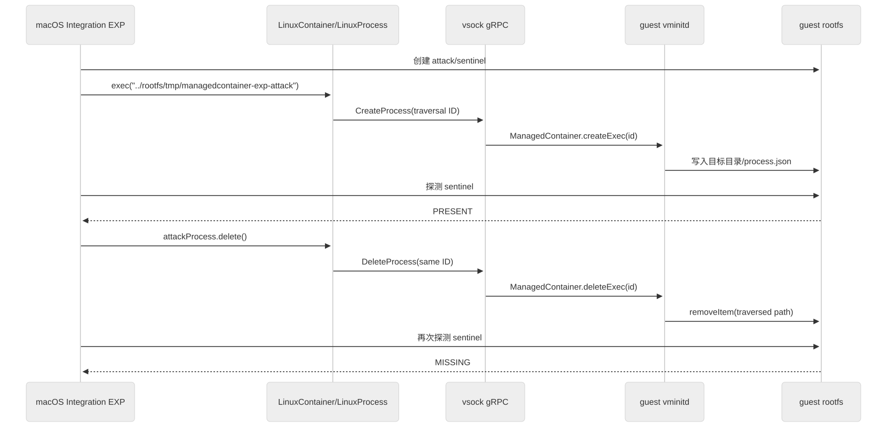

Apple Containerization 使用 Swift 在宿主侧创建轻量 Linux 虚拟机，并通过 vsock 上的 gRPC 服务控制虚拟机中的 `vminitd`。当一个本应只是“进程标识符”的 exec ID 被直接拼接进文件路径时，正常的进程配置清理为什么会变成越界目录删除？

本文以提交 [`41ffd07f3eb4a357405dd69c97f85e3db24a6fc2`](https://github.com/apple/containerization/tree/41ffd07f3eb4a357405dd69c97f85e3db24a6fc2) 为源码基线，沿宿主 API、vsock/gRPC、guest 进程管理和文件删除函数追踪完整数据流，并使用有界的正常组/攻击组 EXP 说明如何验证这条链路。

## 1. 结论先行

这是 `vminitd` 管理容器内附加进程时产生的 **CWE-22 路径穿越目录删除漏洞**。受影响代码把调用者可控的 exec ID 同时当作：

1. 进程的逻辑标识符；
2. `execs/` 下的目录名；
3. `FileManager.removeItem()` 的删除目标组成部分。

攻击者不能只发送一条孤立的删除请求。可行链路要求先使用恶意 ID 成功创建 exec，使该 ID 进入 `ManagedContainer.execs` 表；随后再用相同 ID 删除 exec。删除阶段会将路径穿越后的目录递归移除。

直接影响位于运行 `vminitd` 的 Linux guest VM 中，主要是完整性和可用性破坏。它不等价于远程无认证攻击，也没有证明可以越过 VM 文件系统边界删除任意 macOS 宿主路径。

### 1.1 证据状态

| 证据 | 状态 | 能说明什么 |
| --- | --- | --- |
| 固定提交源码调用链 | 已核对 | exec ID 可以从宿主公开 API 到达 guest 文件路径构造与删除函数 |
| 原始报告的最小 Swift 模拟 | 报告记录为已运行 | `../` 路径经标准库文件操作后能够删除预期目录之外的模拟目标 |
| 本文配套 EXP 的 `--check` | 本轮已运行 | 固定提交正确、易受影响源码匹配、integration 补丁可干净应用 |
| 配套 EXP 的真实 VM `--run` | 本轮未运行 | 需要 Apple silicon、macOS 26、Xcode 26 和历史提交要求的 guest 编译工具链 |

因此，本文将“源码事实”“报告中的模拟观察”“本轮静态检查”和“真实 VM 的预期判据”分别描述，不把尚未执行的 E2E 输出写成实测结果。

## 2. 项目用途与关键术语

Containerization 是一个 Swift 容器运行库，不是“只能运行 Swift 程序的容器”。Swift 负责宿主侧控制面；容器中仍可运行 Bash、Python、Nginx 等普通 Linux 程序。

固定提交的项目 README 说明，每个 Linux 容器运行在独立的轻量 VM 中，guest 内的 `vminitd` 作为初始进程提供 vsock gRPC API，用于配置运行环境和启动容器进程。[项目设计说明](https://github.com/apple/containerization/blob/41ffd07f3eb4a357405dd69c97f85e3db24a6fc2/README.md#design)

当前仓库后来增加了 Linux 上的 cloud-hypervisor 后端，但本文的源码证明和配套 E2E 都固定在报告提交，使用该提交对应的 macOS Virtualization.framework 构建与运行模型。漏洞目标始终是 guest 中共享的 `vminitd` 进程管理逻辑。

```text
macOS 宿主
  └─ Containerization Swift 库
      ├─ LinuxContainer / LinuxProcess
      ├─ Virtualization.framework
      └─ vsock gRPC 客户端
             │
             ▼
Linux guest VM
  └─ vminitd（PID 1）
      ├─ CreateProcess / StartProcess
      ├─ WaitProcess / DeleteProcess
      ├─ ManagedContainer
      └─ vmexec
          └─ 实际容器进程
```

本文使用以下术语：

- **host（宿主）**：运行 Swift Containerization 库和 Virtualization.framework 的 macOS 系统。
- **guest（客户机）**：每个容器所在的轻量 Linux VM。
- **vsock**：宿主与 VM 之间的虚拟套接字通信机制，不是普通互联网 TCP 监听端口。
- **exec 进程**：容器启动后附加运行的进程，语义类似 `docker exec`；这里的 `exec` 不是某个可执行文件名。
- **bundle**：`vminitd` 在 guest 中维护的容器运行时目录，基准路径为 `/run/container/<containerID>`。
- **rootfs**：容器看到的根文件系统，在 guest 中挂载到 bundle 下的 `rootfs/`。

## 3. 漏洞概况

| 项目 | 内容 |
| --- | --- |
| 受影响组件 | guest `vminitd` 的 `ManagedContainer` exec 生命周期管理 |
| 受影响功能 | exec 配置创建、登记与删除清理 |
| 输入 | `CreateProcessRequest.id`、`DeleteProcessRequest.id` |
| 文件系统汇点 | `FileManager.removeItem(at:)` |
| 漏洞类型 | CWE-22：路径名未限制在预期目录内 |
| 源码基线 | `41ffd07f3eb4a357405dd69c97f85e3db24a6fc2` |
| 报告严重性 | High，研究报告提供的向量为 `CVSS:3.1/AV:L/AC:L/PR:L/UI:N/S:U/C:N/I:H/A:H` |

这里的严重性和向量来自配套的 [ISSUE REPORT](https://gist.githubusercontent.com/YLChen-007/1e4f6b430d0f69f376b04b778be6f6ea/raw/7c1789532ebde289644c05519d17da00ef61f5ab/ManagedContainer-Directory-Deletion-Variant-ISSUE-REPORT.md)，不是本文从 Apple、CNA 或 NVD 安全公告中提取的官方评分。

## 4. 威胁模型

### 4.1 攻击者需要具备什么能力

攻击者必须能够控制 exec ID，并推动一次完整的 exec 创建和删除流程。现实入口可以是：

- 上层宿主应用把租户输入直接传给公开的 `LinuxContainer.exec(id:)`；
- 已经具备 guest 控制面访问能力的调用者直接构造 CreateProcess 和 DeleteProcess gRPC 请求。

在固定提交中，`LinuxContainer.exec` 公开接收字符串 ID，并将其保存到 `LinuxProcess`：[LinuxContainer.swift#L855-L890](https://github.com/apple/containerization/blob/41ffd07f3eb4a357405dd69c97f85e3db24a6fc2/Sources/Containerization/LinuxContainer.swift#L855-L890)。

```swift
public func exec(
    _ id: String,
    configuration: @Sendable @escaping (inout LinuxProcessConfiguration) throws -> Void
) async throws -> LinuxProcess {
    // ...
    let process = LinuxProcess(
        id,
        containerID: self.id,
        // ...
    )
    // ...
}
```

### 4.2 受害者需要执行什么操作

宿主应用需要：

1. 已经创建并启动一个容器；
2. 使用攻击者控制的 ID 创建并启动附加 exec；
3. 在 exec 结束后调用其删除或清理接口。

### 4.3 不应默认成立的条件

- 普通远程网络用户不能因为知道 gRPC 方法名就直接访问 vsock。
- 普通容器进程不天然拥有 vminitd 控制接口的调用能力。
- 能在容器内执行命令，不等价于能控制宿主应用传给 `LinuxContainer.exec` 的 ID。
- 能利用 guest 内路径穿越，不等价于能直接访问任意 macOS 宿主路径。

## 5. 正常的 exec 生命周期

`SandboxContext.proto` 把进程生命周期拆分为 `CreateProcess`、`StartProcess`、`WaitProcess` 和 `DeleteProcess` 等 RPC。[SandboxContext.proto#L32-L45](https://github.com/apple/containerization/blob/41ffd07f3eb4a357405dd69c97f85e3db24a6fc2/Sources/Containerization/SandboxContext/SandboxContext.proto#L32-L45)

假设容器 ID 为 `demo`，exec ID 为 `shell-1`。正常情况下，guest 中的配置目录是：

```text
/run/container/demo/execs/shell-1/
└── process.json
```

各字段含义如下：

- `/run/container/demo`：容器 bundle；
- `execs/`：附加进程配置目录；
- `shell-1`：调用方提供的 exec ID；
- `process.json`：该进程的 OCI Process 配置。

正常状态变化是：

```text
LinuxContainer.exec("shell-1")
  → LinuxProcess.start()
  → CreateProcess(id="shell-1", containerID="demo")
  → guest 创建 execs/shell-1/process.json
  → guest 将 execs["shell-1"] 记入内存表
  → StartProcess / WaitProcess
  → LinuxProcess.delete()
  → DeleteProcess(id="shell-1", containerID="demo")
  → guest 删除 execs/shell-1
  → guest 移除 execs["shell-1"]
```

问题不在“进程结束后删除配置目录”这一设计本身，而在于代码没有保证 `id` 始终只是一个路径组件。

## 6. 从宿主 API 到 guest 文件系统的完整数据流

### 6.1 宿主创建路径：ID 进入 CreateProcessRequest

调用 `LinuxProcess.start()` 时，宿主把 `self.id` 和 `owningContainer` 传给 agent 的 `createProcess`：[LinuxProcess.swift#L238-L278](https://github.com/apple/containerization/blob/41ffd07f3eb4a357405dd69c97f85e3db24a6fc2/Sources/Containerization/LinuxProcess.swift#L238-L278)。

```swift
try await agent.createProcess(
    id: self.id,
    containerID: self.owningContainer,
    // ...
    configuration: spec,
    options: nil
)
```

`vminitd` 收到请求后，如果 `containerID` 对应的容器已经存在，就把 `request.id` 原样传给 `createExec`：[Server+GRPC.swift#L695-L743](https://github.com/apple/containerization/blob/41ffd07f3eb4a357405dd69c97f85e3db24a6fc2/vminitd/Sources/vminitd/Server+GRPC.swift#L695-L743)。

```swift
if let container = await self.state.containers[request.containerID] {
    try await container.createExec(
        id: request.id,
        stdio: stdioPorts,
        process: process
    )
}
```

### 6.2 Guest 创建路径：恶意 ID 先被登记

`ManagedContainer.createExec` 先写配置文件，再创建 `ManagedProcess`，最后把同一个 ID 放入 `execs` 字典：[ManagedContainer.swift#L151-L180](https://github.com/apple/containerization/blob/41ffd07f3eb4a357405dd69c97f85e3db24a6fc2/vminitd/Sources/vminitd/ManagedContainer.swift#L151-L180)。

```swift
try self.bundle.createExecSpec(
    id: id,
    process: process
)

let process = try ManagedProcess(
    id: id,
    // ...
)

self.execs[id] = process
```

`createExecSpec` 直接把 ID 拼接到 `execs/` 后面，并在该位置创建目录和写入 `process.json`：

```swift
let specDir = self.path.appending(path: "execs/\(id)")
try fm.createDirectory(
    atPath: specDir.path,
    withIntermediateDirectories: true
)

let processConfigPath = specDir.appending(path: "process.json")
try specData.write(to: processConfigPath)
```

这一步说明漏洞不仅依赖删除函数。恶意 ID 必须首先通过创建流程，目标路径必须是可创建或已经存在的目录，并且 `vminitd` 需要有权在其中写入 `process.json`。

### 6.3 宿主删除路径：相同 ID 进入 DeleteProcessRequest

宿主调用 `LinuxProcess.delete()` 后，`performDeletion()` 把相同的 ID 发送给 `deleteProcess`：[LinuxProcess.swift#L411-L439](https://github.com/apple/containerization/blob/41ffd07f3eb4a357405dd69c97f85e3db24a6fc2/Sources/Containerization/LinuxProcess.swift#L411-L439)。

```swift
try await self.agent.deleteProcess(
    id: self.id,
    containerID: self.owningContainer
)
```

guest gRPC handler 取得容器后，将非 init 进程交给 `deleteExec`：[Server+GRPC.swift#L844-L870](https://github.com/apple/containerization/blob/41ffd07f3eb4a357405dd69c97f85e3db24a6fc2/vminitd/Sources/vminitd/Server+GRPC.swift#L844-L870)。

```swift
if request.id == request.containerID {
    try await ctr.delete()
    try await state.remove(container: request.id)
} else {
    try await ctr.deleteExec(id: request.id)
}
```

### 6.4 文件系统汇点：removeItem 删除穿越后的目录

`deleteExec` 首先确认 ID 存在，然后调用 `deleteExecSpec`：[ManagedContainer.swift#L208-L215](https://github.com/apple/containerization/blob/41ffd07f3eb4a357405dd69c97f85e3db24a6fc2/vminitd/Sources/vminitd/ManagedContainer.swift#L208-L215)。

```swift
func deleteExec(id: String) throws {
    try ensureExecExists(id)
    do {
        try self.bundle.deleteExecSpec(id: id)
    } catch {
        self.log.error("failed to remove exec spec from filesystem: \(error)")
    }
    self.execs.removeValue(forKey: id)
}
```

最终汇点仍然使用同样的字符串拼接：[ManagedContainer.swift#L270-L274](https://github.com/apple/containerization/blob/41ffd07f3eb4a357405dd69c97f85e3db24a6fc2/vminitd/Sources/vminitd/ManagedContainer.swift#L270-L274)。

```swift
let specDir = self.path.appending(path: "execs/\(id)")
try fm.removeItem(at: specDir)
```

如果 bundle 为：

```text
/run/container/demo
```

配套 E2E 使用的恶意 ID 为：

```text
../rootfs/tmp/managedcontainer-exp-attack
```

那么词法构造路径是：

```text
/run/container/demo/execs/../rootfs/tmp/managedcontainer-exp-attack
```

文件系统解析 `..` 后，实际目标是：

```text
/run/container/demo/rootfs/tmp/managedcontainer-exp-attack
```

该目录对应容器内看到的：

```text
/tmp/managedcontainer-exp-attack
```

于是，“删除 exec 配置目录”被转换成了“递归删除容器 rootfs 中的攻击目标目录”。

## 7. 为什么单独发送 DeleteProcess 不够

报告摘要强调 `DeleteProcessRequest.id` 未校验，但完整利用链还受 `ensureExecExists` 约束：

```swift
private func ensureExecExists(_ id: String) throws {
    if self.execs[id] == nil {
        throw ContainerizationError(
            .invalidState,
            message: "exec \(id) does not exist in container \(self.id)"
        )
    }
}
```

因此，以下序列通常会失败：

```text
只发送 DeleteProcess(恶意 ID)
  → execs[恶意 ID] 不存在
  → invalidState
  → 不进入 removeItem
```

可行序列是：

```text
CreateProcess(恶意 ID)
  → createExecSpec 在穿越后的目录写入 process.json
  → ManagedProcess 创建成功
  → execs[恶意 ID] = process

DeleteProcess(同一恶意 ID)
  → ensureExecExists 通过
  → deleteExecSpec 再次构造穿越路径
  → removeItem 递归删除目标目录
```

这个前置条件也限定了“任意文件删除”的表述。若最终目标是一个已经存在的普通文件，创建阶段无法把它作为目录并在下面写入 `process.json`，攻击链通常无法完成登记。因此，更准确的直接结论是：

> 攻击者可以递归删除 `vminitd` 文件系统视图中可写、可访问并能通过创建阶段的目标目录；目录内的文件会随目录一起被删除，但本文没有证明能够直接指定任意单个现有文件作为最终目标。

## 8. 安全影响与边界

### 8.1 直接影响

- **完整性破坏**：攻击目标目录及其内容被删除；创建阶段还会在目标目录写入或覆盖固定名称的 `process.json`。
- **可用性破坏**：如果目标是 guest 运行时状态、配置或关键服务目录，相关容器或 VM 内服务可能无法继续工作。
- **同 VM 影响**：在一个 VM 中承载多个容器的场景下，能够到达其他容器 bundle 或共享状态目录时，影响可能跨越发起操作的容器。

### 8.2 条件性组合影响

报告提出可以删除日志、socket 或安全组件元数据，从而干扰遥测或策略执行。这类影响只有在以下条件同时满足时才成立：

- 相关组件确实与目标容器位于同一 guest 文件系统视图；
- 其目录能够由穿越路径定位；
- `vminitd` 对目标具有写入和删除权限；
- 删除后没有其他独立机制立即恢复状态。

因此，它们应当描述为可能的组合影响，而不是所有部署中无条件成立的结果。

### 8.3 本文没有证明的影响

- 没有证明机密信息读取或数据外传；报告向量同样标记 `C:N`。
- 没有证明通过该路径直接执行攻击者代码。
- 没有证明未经授权的互联网远程调用者可以到达 vsock gRPC 服务。
- 没有证明可以直接删除任意 macOS 宿主路径。
- 没有证明所有容器内进程都能调用 `DeleteProcess` 控制面。

## 9. 版本证据

原始报告写的是“受影响版本 `<= 0.31.0`，无修复版本”。本地 Git 历史显示，这个字段已经过时：报告固定的提交本身位于 `0.31.0` 之后，并被 `0.32.0` 包含；相同的无校验调用链在 `0.41.0` 中仍然存在，而 `0.42.0` 是本地标签历史中第一个包含相关安全提交的版本。

| 版本或提交 | 静态检查结果 |
| --- | --- |
| `0.31.0` | `ManagedContainer.createExec` 未发现 ID 校验 |
| `41ffd07f...` | 报告固定源码，未发现 ID 校验；随后被 `0.32.0` 包含 |
| `0.32.0` | 未发现 ID 校验 |
| `0.41.0` | 未发现 ID 校验 |
| `0.42.0` | 已包含相关安全提交 |
| 当前本地 HEAD `7723232d...` | 已包含 ID 校验 |

这里的范围是基于本地仓库标签和源码的静态结论，不替代 Apple 官方 advisory 的产品支持声明，也不代表本文对每个历史标签都完成了真实 VM 动态测试。

## 10. 有界验证

### 10.1 原始报告的最小模拟

原始报告提供了一个模拟 `Bundle` 路径创建和删除逻辑的 Swift 目标程序，以及正常/恶意两个 Python 驱动脚本。报告记录的攻击路径是：

```text
/run/container/legit_container/execs/../../../../tmp/hacked_dir
```

并记录 `/tmp/hacked_dir` 在删除后不存在。这个观察可以支持“Swift/Foundation 文件操作会作用于穿越后的目标”这一结论。

但该模拟没有启动真实 VM，也没有经过真实的 `LinuxContainer`、vsock、gRPC server、`ManagedContainer.execs` 状态表和 guest rootfs。因此，它不能单独证明完整产品链路可达。

### 10.2 真实 VM E2E 的验证目标

配套 EXP 位于 [managedcontainer-directory-deletion-e2e](https://gist.githubusercontent.com/YLChen-007/1e4f6b430d0f69f376b04b778be6f6ea/raw/b1a47c026a6e3031e0ee9c0b83380b26d51e74d8/README.md)，固定到报告提交并向项目原有 integration runner 注入一个过滤测试。

实验只删除临时容器 rootfs 中的专用目录，不触碰宿主真实目录：

| 组别 | exec ID | 哨兵目录 | 删除后的必要结果 |
| --- | --- | --- | --- |
| 正常组 | `exp-safe-delete` | `/tmp/managedcontainer-exp-control` | `PRESENT` |
| 攻击组 | `../rootfs/tmp/managedcontainer-exp-attack` | `/tmp/managedcontainer-exp-attack` | `MISSING` |

为了区分“创建阶段写入”和“删除阶段删除”，攻击组设置三个观测点：

1. `attack_before=PRESENT`：恶意 exec 创建前，哨兵存在；
2. `attack_during=PRESENT`：恶意 exec 已创建、运行并退出，但尚未调用 `delete()`，哨兵仍存在；
3. `attack_after=MISSING`：调用 `attackProcess.delete()` 后，哨兵目录消失。

完整链路如下：

<figure class="article-diagram">
  <a href="../../assets/blog/apple-containerization-vminitd-directory-deletion/01-e2e-sequence.svg" title="点击查看完整 SVG 原图">
    
  </a>
  <figcaption>攻击组在 delete() 前后探测哨兵目录，用于区分进程创建与清理阶段。</figcaption>
</figure>

### 10.3 运行命令

任意系统都可以先执行不启动 VM 的源码与补丁匹配检查。该模式会创建并清理一个临时 Git worktree，但不会修改当前工作树：

```bash
./llm-enhance/exp/managedcontainer-directory-deletion-e2e/run.sh --check
```

本轮实际得到：

```text
[EXP] pinned_commit=41ffd07f3eb4a357405dd69c97f85e3db24a6fc2
[EXP] patch_check=PASS
[EXP] CHECK_ONLY=PASS (no build, VM, gRPC call, or deletion was executed)
```

最后一行明确说明：这不是漏洞动态确认，只证明固定提交和 EXP 补丁匹配。

在满足固定提交构建要求的 Apple silicon Mac 上，真实 E2E 命令是：

```bash
./llm-enhance/exp/managedcontainer-directory-deletion-e2e/run.sh --run
```

### 10.4 动态判定标准

以下内容是 **成功运行真实 VM E2E 时的预期判据，不是本轮实测日志**：

```text
[EXP] control_before=PRESENT
[EXP] control_after=PRESENT
[EXP] traversal_id=../rootfs/tmp/managedcontainer-exp-attack
[EXP] lexical_delete_path=/run/container/managedcontainer-directory-deletion-exp/execs/../rootfs/tmp/managedcontainer-exp-attack
[EXP] resolved_delete_path=/run/container/managedcontainer-directory-deletion-exp/rootfs/tmp/managedcontainer-exp-attack
[EXP] attack_before=PRESENT
[EXP] attack_during=PRESENT
[EXP] attack_after=MISSING
[EXP] RESULT=VULNERABLE
[EXP] E2E_RESULT=VULNERABLE
```

只有同时看到正常组保留哨兵、攻击组在 `delete()` 前存在并在 `delete()` 后消失，而且 integration runner 成功退出，才能把结果写成这条真实 VM 链路的动态确认。

### 10.5 EXP 能证明与不能证明什么

成功运行后，它能够证明：

- 恶意 ID 从公开 `LinuxContainer.exec(id:)` 到达真实 guest `vminitd`；
- `CreateProcess` 能用该 ID 建立 exec 状态；
- `DeleteProcess` 能让清理路径越过 `execs/`；
- 删除真实发生在 guest rootfs，而不是只计算出一个字符串路径。

它仍然不能证明：

- 普通容器进程天然拥有 vminitd 控制权限；
- 未经授权的远程网络攻击者可以到达 vsock；
- 攻击能够越过 VM 边界删除任意宿主目录；
- 任意单个现有文件都可以直接作为最终删除目标。

## 11. 总结

这个漏洞的本质不是 `FileManager.removeItem()` 本身危险，而是同一个未受约束的 exec ID 跨越了多个信任阶段：

```text
宿主公开 API 输入
  → CreateProcessRequest.id
  → guest createExec
  → bundle 路径组件
  → execs 内存键
  → DeleteProcessRequest.id
  → deleteExecSpec
  → 递归目录删除
```

正常 ID 让创建、启动和清理都局限在 `execs/<id>`。包含 `../` 的 ID 则把进程生命周期状态与 guest 文件系统路径绑定到预期目录之外。由于删除前存在 `ensureExecExists`，完整利用必须是 `CREATE → DELETE`，而不是一条孤立的删除请求。

在影响表述上，最稳妥的结论是：具备 exec ID 控制能力并能推动完整生命周期的调用者，可以递归删除同一 guest VM 文件系统视图中满足创建和权限条件的目录，造成完整性与可用性破坏。远程可达性、跨 VM 删除、安全组件失效以及宿主文件影响都需要额外前提，不能由这条源码链无条件推出。

## 参考资料

- [配套漏洞报告](https://gist.githubusercontent.com/YLChen-007/1e4f6b430d0f69f376b04b778be6f6ea/raw/7c1789532ebde289644c05519d17da00ef61f5ab/ManagedContainer-Directory-Deletion-Variant-ISSUE-REPORT.md)
- [固定提交 `41ffd07f...`](https://github.com/apple/containerization/tree/41ffd07f3eb4a357405dd69c97f85e3db24a6fc2)
- [`LinuxContainer.exec`](https://github.com/apple/containerization/blob/41ffd07f3eb4a357405dd69c97f85e3db24a6fc2/Sources/Containerization/LinuxContainer.swift#L855-L890)
- [`LinuxProcess.start` 与 CreateProcess](https://github.com/apple/containerization/blob/41ffd07f3eb4a357405dd69c97f85e3db24a6fc2/Sources/Containerization/LinuxProcess.swift#L238-L278)
- [`LinuxProcess.delete` 与 DeleteProcess](https://github.com/apple/containerization/blob/41ffd07f3eb4a357405dd69c97f85e3db24a6fc2/Sources/Containerization/LinuxProcess.swift#L411-L439)
- [`vminitd` CreateProcess/DeleteProcess handler](https://github.com/apple/containerization/blob/41ffd07f3eb4a357405dd69c97f85e3db24a6fc2/vminitd/Sources/vminitd/Server+GRPC.swift#L695-L870)
- [`ManagedContainer` 创建与删除路径](https://github.com/apple/containerization/blob/41ffd07f3eb4a357405dd69c97f85e3db24a6fc2/vminitd/Sources/vminitd/ManagedContainer.swift#L151-L275)
- [配套有界 E2E EXP](https://gist.githubusercontent.com/YLChen-007/1e4f6b430d0f69f376b04b778be6f6ea/raw/b1a47c026a6e3031e0ee9c0b83380b26d51e74d8/README.md)
