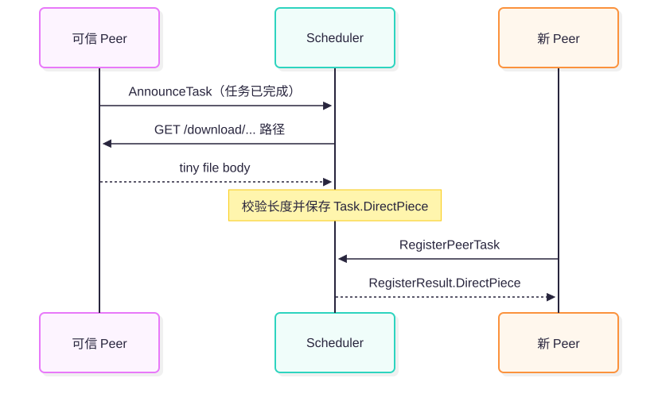
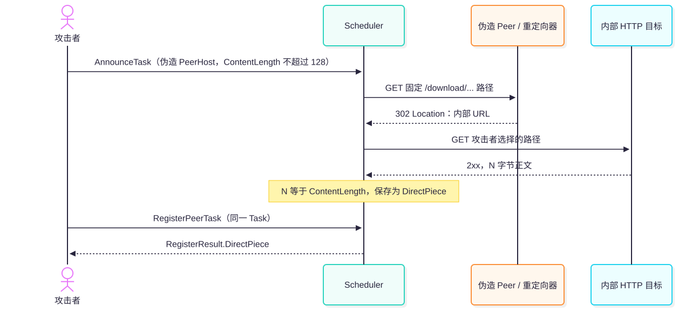

> 本文仅用于授权环境中的漏洞研究与防御验证。文中的 HTTP 目标均为本地隔离网络中的 mock 服务，不包含对真实云元数据、生产内网或第三方服务的探测。

| 项目 | 信息 |
| --- | --- |
| 漏洞类型 | CWE-918，服务端请求伪造（SSRF） |
| 当前规范编号 | `CVE-2026-54709` / [`GHSA-fhf9-m53m-863g`](https://github.com/dragonflyoss/dragonfly/security/advisories/GHSA-fhf9-m53m-863g) |
| 官方严重性 | Critical；CVE CNA 记录的 CVSS v4.0 基础分为 9.8 |
| 受影响版本 | `<= 2.4.4-rc.2` |
| 修复版本 | `2.4.4-rc.3` |

## TL;DR

- **漏洞根因：** Scheduler v1 接受调用者声明的 `PeerHost.Ip`、`PeerHost.DownPort` 和任务长度。当任务被
  标记为不超过 128 字节的 `TINY` 任务后，Scheduler 会主动向该地址发起 HTTP GET，却没有验证出站目的地
  是否属于可信 Peer。
- **利用链：** 攻击者可以让 Scheduler 直接请求满足固定 `/download/...` 路径的目标，也可以控制首跳
  HTTP 服务返回 302，把固定下载路径转换成攻击者选择的第二跳主机、端口、路径和查询参数。302 不是触发
  SSRF 的必要条件，但会显著扩大可触达目标。
- **数据回传：** 最终目标的 2xx 响应在长度与攻击者声明值一致时会进入 `Task.DirectPiece`；攻击者随后
  注册同一 Task，即可通过 `RegisterResult.DirectPiece` 取回最多 128 字节，形成有回显的读取型 SSRF。
- **利用前提与边界：** 攻击者需要能够访问 Scheduler v1 gRPC 接口，并让 Scheduler 同时访问首跳和最终
  目标；请求方法固定为 GET，目标必须返回长度匹配的响应，网络策略、mTLS 和目标自身认证都可能阻断链路。
- **验证与修复：** 本文在隔离网络中对 `v2.4.3` 完成了“首跳 → 302 → 第二跳 → `DirectPiece`”端到端
  验证。`2.4.4-rc.3` 开始在 HTTP `DialContext` 中接入 `SafeDialer`，阻止 loopback、link-local 等非
  global-unicast 地址；但 Go 的 `IsGlobalUnicast()` 仍会接受 RFC1918 私网地址，因此不能把该机制理解为
  完整的合法 Peer 或私网目的地 allowlist。

## 0. 问题与结论

本文要回答的问题是：**Dragonfly2 为 tiny 文件设计的直接回传优化，为什么会让 Scheduler 变成能够读取第二跳 HTTP 响应的服务端请求代理？**

答案可以压缩为一条因果链：

<figure class="article-diagram">
  
</figure>

本文在固定版本 `v2.4.3`、提交
[`e1491bf6134fe307b09e82e11fa94b0587dcd323`](https://github.com/dragonflyoss/dragonfly/commit/e1491bf6134fe307b09e82e11fa94b0587dcd323)
上完成了源码分析和端到端验证。实验观察到 Scheduler 访问了攻击者控制的重定向器和第二跳 mock 目标，并通过 `DirectPiece` 返回随机标记，EXP 退出码为 `0`。

需要先限定结论：

- **源码事实：** `v2.4.3` 的 `DownloadTinyFile` 没有出站目标校验，并使用会自动跟随重定向的 Go HTTP 客户端。
- **实验观察：** 隔离环境中的 `v2.4.3` Scheduler 完成了“首跳 → 302 → 第二跳 → `DirectPiece` 回显”的完整链路。
- **报告范围：** 当前规范公告将受影响范围描述为 `<= 2.4.4-rc.2`、修复版本标为 `2.4.4-rc.3`；
  本文只对 `v2.4.3` 做了动态验证，不把单版本实验外推为所有受影响版本均已实测。
- **修复状态：** 修复提交
  [`4f9bd93d`](https://github.com/dragonflyoss/dragonfly/commit/4f9bd93d22453e3f433f9d912bfeeca22760c237)
  首次进入 `v2.4.4-rc.3`，并已包含在后续稳定版
  [`v2.4.4`](https://github.com/dragonflyoss/dragonfly/releases/tag/v2.4.4) 中。

## 1. 先认识漏洞涉及的组件

理解这个漏洞的关键，不是先看某一行 `http.Client`，而是先理解 Dragonfly2 为什么需要由 Scheduler 主动访问 Peer，以及 tiny 文件为什么会被特殊处理。

### 1.1 Dragonfly2：面向文件与镜像分发的 P2P 系统

Dragonfly2 用 P2P 方式分发容器镜像、文件和其他制品。与每个客户端都直接访问源站不同，已经拥有数据的节点可以成为后续下载者的上游，从而减少源站压力并提升集群内分发效率。

官方架构将系统角色概括为 Manager、Scheduler、Seed Peer 和 Peer。正常情况下，控制信息通过 Manager
与 Scheduler 流动，实际文件数据则在 Seed Peer、普通 Peer 和源站之间传输。可参考
[Dragonfly Introduction](https://d7y.io/docs/) 和
[Scheduler 文档](https://d7y.io/docs/v2.2.0/operations/deployment/applications/scheduler/)。

<figure class="article-diagram">
  
</figure>

### 1.2 Manager：集群关系与动态配置管理

Manager 负责管理 Scheduler 集群、Seed Peer 集群及其关系，并向客户端提供 Scheduler 发现、动态配置、
保活和管理能力。它更接近控制平面的“集群目录和配置中心”，通常不直接承载普通 Piece 的 P2P 数据传输。

在本漏洞的利用链中，Manager 不是 SSRF 请求的直接发起者。它的作用主要是让 Scheduler 能够以完整集群成员身份启动并获得动态配置。本次 E2E 环境因此部署了 Manager，但真正访问重定向器和第二跳目标的是 Scheduler。

### 1.3 Scheduler：掌握元数据和网络位置的调度中心

Scheduler 维护三个与本文直接相关的资源：

| 资源 | 含义 | 关系 |
| --- | --- | --- |
| `Host` | 运行客户端/Peer 的主机信息，包括 IP 和下载端口 | 一个 Host 可以拥有多个 Peer |
| `Task` | 一份待分发内容，由 URL 与 URLMeta 等信息形成 TaskID | 一个 Task 可以被多个 Peer 下载 |
| `Peer` | 某个 Host 参与某个 Task 下载时的实例 | 连接 Host 与 Task |

三类元数据的关系如下：

<figure class="article-diagram">
  
</figure>

Scheduler 根据这些元数据维护 Peer DAG、选择 Parent Peer，并在必要时触发 Seed Peer 或普通 Peer 回源。也正因为 Scheduler 需要告诉下载者“去哪个 Peer 取数据”，它通常能访问集群内多个节点和端口，具有比外部调用者更强的网络可达性。

这构成了 SSRF 的价值：攻击者希望借用的不是 Scheduler 的业务身份，而是它所在网络位置的访问能力。

### 1.4 dfdaemon、Peer 与 PeerHost

dfdaemon 是 Dragonfly 客户端守护进程。它接收下载任务、向 Scheduler 注册 Task，并在 P2P 网络中上传
或下载 Piece。官方文档对其关系的概括是：dfdaemon 从 Manager 获取 Scheduler，并向 Scheduler 注册
P2P 任务，随后与其他 dfdaemon 传输数据，参见
[Dfdaemon 文档](https://d7y.io/docs/v2.0.8/concepts/terminology/dfdaemon/)。

在 Scheduler v1 API 中，客户端会提交 `PeerHost`，其中包含：

- `Id`：Host 标识；
- `Ip`：Peer 对外提供下载服务的地址；
- `DownPort`：下载端口；
- `RpcPort`：RPC 端口；
- `Hostname`、机房和位置信息。

正常设计中，Scheduler 信任 `Ip + DownPort` 能够定位这个 Peer 的下载服务。漏洞版本没有把它当作需要安全约束的网络目的地，而只是把它当作普通调度元数据保存下来。

### 1.5 Task、Piece、PeerTask 与 Parent Peer

几个容易混淆的概念需要区分：

- **Task：** 一份逻辑下载内容。相同 URL 和 URLMeta 通常映射到相同 TaskID。
- **Piece：** 大文件被拆分后的数据片段，用于并行下载和多 Peer 分发。
- **PeerTask/Peer：** 某个 Peer 参与某个 Task 的一次下载实例，可理解为 `Peer + Task`。
- **Parent Peer：** Scheduler 为当前下载 Peer 选择的上游数据节点。

普通文件会被拆成 Piece，下载者从一个或多个 Parent Peer 获取数据。Scheduler 主要维护元数据和调度关系，并不需要把整个文件放进一次 gRPC 响应。

### 1.6 Tiny 文件与 `DirectPiece`

对于极小内容，完整执行“选择 Parent → 建立 Peer 数据连接 → 下载 Piece → 汇报状态”的成本可能比文件本身还大。因此 Scheduler v1 实现了一条 tiny-file 快速路径。

在 `v2.4.3` 中，
[`Task.SizeScope`](https://github.com/dragonflyoss/dragonfly/blob/e1491bf6134fe307b09e82e11fa94b0587dcd323/scheduler/resource/standard/task.go#L536-L555)
的实际判断是：

```go
if t.ContentLength.Load() == EmptyFileSize {
    return commonv2.SizeScope_EMPTY
}

if t.ContentLength.Load() <= TinyFileSize {
    return commonv2.SizeScope_TINY
}
```

其中 `TinyFileSize = 128`。因此非空且内容长度不超过 128 字节的任务会进入 `TINY` 路径。这里以源码为准：边界值 128 也属于 `TINY`。

`DirectPiece` 是 Scheduler 内存中保存的 tiny 文件完整内容。后续 Peer 注册相同 Task 时，Scheduler 可以直接把这段字节放入 `RegisterResult`，省去额外的 Peer 数据下载。

### 1.7 两套协议：gRPC 控制面与 HTTP 数据面

本漏洞横跨两种协议：

| 协议 | 方向 | 在漏洞链中的作用 |
| --- | --- | --- |
| Scheduler v1 gRPC | 调用者 → Scheduler | 提交 Task、PeerHost、内容长度，并取回 `DirectPiece` |
| HTTP/HTTPS | Scheduler → Peer/第二跳目标 | 下载 tiny 文件正文 |

这意味着入口虽然是 gRPC，危险动作却发生在 Scheduler 的 HTTP 出站请求中。只检查 gRPC 字段格式，而不检查它最终形成的网络连接，并不能阻止 SSRF。

## 2. 漏洞概况与威胁模型

### 2.1 攻击者能力

在默认未启用 mTLS、且 Scheduler v1 gRPC 端口对攻击者可达的部署中，攻击者需要能够：

1. 调用 `AnnounceTask` 和 `RegisterPeerTask`；
2. 构造唯一的 TaskID、PeerID 和 `PeerHost`；
3. 声明一个 `0 < ContentLength <= 128`、`TotalPiece = 1` 的任务；
4. 让 Scheduler 能够访问一个攻击者控制的 HTTP Peer/重定向器；
5. 让最终目标返回长度与声明值一致的 2xx 响应，才能完成 `DirectPiece` 回显。

这里的“未认证”是默认配置结论，而不是所有部署的绝对属性。`v2.4.3` 的 gRPC 拦截器包含限速、日志、
指标、protobuf 校验和 panic recovery，但没有应用层身份认证拦截器；Scheduler TLS 则是可选配置（当前版本默认不启用）。若部署
启用了 mTLS，攻击者还需要合法客户端证书或等价身份能力。相关源码见
[`pkg/rpc/scheduler/server/server.go`](https://github.com/dragonflyoss/dragonfly/blob/e1491bf6134fe307b09e82e11fa94b0587dcd323/pkg/rpc/scheduler/server/server.go#L54-L101)
和
[`scheduler/scheduler.go`](https://github.com/dragonflyoss/dragonfly/blob/e1491bf6134fe307b09e82e11fa94b0587dcd323/scheduler/scheduler.go#L215-L233)。

### 2.2 攻击目标与资产

被借用的是 Scheduler 的出站网络权限。潜在目标包括：

- Scheduler loopback 上的 HTTP 服务；
- 链路本地地址，例如部分云环境的元数据地址；
- Scheduler 可达但攻击者不可直接访问的容器、节点或管理网段；
- 无认证的内部状态、调试或管理接口；
- 使用 GET 产生副作用的旧式内部 API。

不能把“网络可达”直接写成“必然能读取敏感数据”。Scheduler 不会自动为第二跳附加 Kubernetes Bearer Token、云元数据专用请求头或目标服务凭证。要求特殊 Header、POST、客户端证书或复杂会话的目标通常不能直接利用这条链读取。

### 2.3 信任边界

漏洞跨越了三个边界：

<figure class="article-diagram">
  
</figure>

仅有前两个边界会形成“盲 SSRF”；第三个边界让攻击者能够直接得到响应正文，使问题升级为有回显的 SSRF。

### 2.4 现实限制

这条利用链有明确边界：

- 请求方法固定为 `GET`，不是通用 TCP 代理；
- `PeerHost.DownPort` 的 protobuf 校验范围是 `[1024, 65535)`，因此不能直接指定 80 等低端口；
- 首跳 URL 路径固定为 Dragonfly 下载路径；
- 完整回显要求响应长度与攻击者声明值相等，且该值不超过 128；
- 出站 ACL、NetworkPolicy、Service Mesh 或主机防火墙可能阻止连接；
- mTLS 和严格的 gRPC 网络隔离会提高入口门槛；
- 目标如果要求额外身份凭证，单纯 SSRF 并不会自动获得这些凭证。

重定向并不是利用的绝对前提：如果内部目标本身接受固定的 `/download/...` 路径，攻击者可以直接把 `PeerHost.Ip/DownPort` 指向它。302 的价值在于把固定首跳路径转换成攻击者选择的第二跳路径、查询参数和主机，从而显著扩大可触达目标。

## 3. 正常的 tiny-file 处理流程

先看设计意图，才能区分“Scheduler 主动下载”与“SSRF”之间的边界。

正常情况下，一个合法 Peer 已经完成 tiny Task：

1. Peer 通过 `AnnounceTask` 告知 Scheduler：任务完成、总 Piece 数量和内容长度是多少；
2. Scheduler 把 Task 状态推进到 `Succeeded`；
3. 因为 Task 属于 `TINY`，Scheduler 从这个 Peer 的 HTTP 下载端口读取完整正文；
4. Scheduler 校验实际字节数是否等于 `ContentLength`；
5. 校验通过后，把正文保存到 `Task.DirectPiece`；
6. 新 Peer 调用 `RegisterPeerTask` 时，Scheduler 直接返回 `DirectPiece`。

正常流量可以表示为：

<figure class="article-diagram">
  
</figure>

这里真正缺失的是：Scheduler 没有证明被宣告的 Peer 地址属于合法 Peer，也没有把出站连接限制在允许的目标集合内。

## 4. 从不可信字段到 SSRF 的源码调用链

### 4.1 `AnnounceTask` 接收攻击者声明的 Host 和长度

[`V1.AnnounceTask`](https://github.com/dragonflyoss/dragonfly/blob/e1491bf6134fe307b09e82e11fa94b0587dcd323/scheduler/service/service_v1.go#L332-L413)
从请求中取得：

```go
taskID := req.GetTaskId()
peerID := req.PiecePacket.GetDstPid()

host := v.storeHost(ctx, req.GetPeerHost())
peer := v.storePeer(ctx, peerID, ..., task, host)
```

随后它把 `PiecePacket` 中的 `TotalPiece` 和 `ContentLength` 传给 `handleTaskSuccess`。后者直接更新 Task：

```go
task.TotalPieceCount.Store(req.GetTotalPieceCount())
task.ContentLength.Store(req.GetContentLength())
```

因此，攻击者同时影响了两个关键状态：

- Scheduler 将去哪里下载：`PeerHost.Ip + PeerHost.DownPort`；
- Scheduler 是否进入 tiny 路径：`ContentLength <= 128`。

### 4.2 `storeHost` 把网络位置保存为可信资源

[`storeHost`](https://github.com/dragonflyoss/dragonfly/blob/e1491bf6134fe307b09e82e11fa94b0587dcd323/scheduler/service/service_v1.go#L816-L850)
创建 Host 时直接传入客户端字段：

```go
host := resource.NewHost(
    peerHost.Id,
    peerHost.Ip,
    peerHost.Hostname,
    peerHost.Hostname,
    peerHost.RpcPort,
    peerHost.DownPort,
    peerHost.ProxyPort,
    types.HostTypeNormal,
    options...,
)
```

这里并非完全没有输入校验。项目使用的 `d7y.io/api/v2 v2.2.24` 在
[`PeerHost`](https://github.com/dragonflyoss/api/blob/v2.2.24/pkg/apis/scheduler/v1/scheduler.proto#L76-L101)
上定义了 protobuf 校验规则：

```protobuf
string id = 1 [(validate.rules).string.min_len = 1];
string ip = 2 [(validate.rules).string.ip = true];
int32 down_port = 4 [(validate.rules).int32 = {
  gte: 1024
  lt: 65535
}];
```

这些规则只能证明 `Id` 非空、`Ip` 在语法上是 IP、`DownPort` 位于允许的数值区间；它们不能证明请求者
拥有该地址，也不能判断该地址是否属于合法 Peer 或允许访问的网络。真正缺失的是身份、来源和目的地址之间
的绑定。

#### 4.2.1 未检查 Host 是否已在 Manager 注册

`storeHost` 首先查询的是 Scheduler 进程内的 `HostManager`：

```go
host, loaded := v.resource.HostManager().Load(peerHost.Id)
if !loaded {
    host := resource.NewHost(
        peerHost.Id,
        peerHost.Ip,
        peerHost.Hostname,
        peerHost.Hostname,
        peerHost.RpcPort,
        peerHost.DownPort,
        peerHost.ProxyPort,
        types.HostTypeNormal,
        options...,
    )

    v.resource.HostManager().Store(host)
    return host
}
```

这里的 `HostManager` 是 Scheduler 本地资源容器，不是 Dragonfly 的 Manager 服务。它的 `Store` 最终只是
写入内存中的 `sync.Map`：

```go
func (h *hostManager) Store(host *Host) {
    // 省略 normal/seed 分类索引。
    h.Map.Store(host.ID, host)
}
```

相关实现见
[`standard/host_manager.go`](https://github.com/dragonflyoss/dragonfly/blob/e1491bf6134fe307b09e82e11fa94b0587dcd323/scheduler/resource/standard/host_manager.go#L127-L161)。
该路径没有调用 Manager 查询 Host，也没有要求 `PeerHost.Id` 预先存在。攻击者只需选择一个未使用的随机
HostID，就会进入 `!loaded` 分支并创建新的 Host。需要注意：若复用一个已经存在的 HostID，当前分支不会
覆盖其 IP；EXP 使用唯一 ID，保证走新建分支，因此不依赖 HostID 碰撞。

#### 4.2.2 未证明请求者控制所声明的 Host

函数签名写成：

```go
func (v *V1) storeHost(
    _ context.Context,
    peerHost *schedulerv1.PeerHost,
) *resource.Host
```

下划线表明传入的 gRPC `context.Context` 根本没有被读取。函数没有从 Context 中取得客户端证书、认证主体
或连接对端，也没有向 `PeerHost.Ip:DownPort` 发起带随机挑战的所有权验证。它只是把请求正文中的字段复制
到 Host。因此，“能够提交 protobuf 字段”被错误地当成了“能够代表这个 Host”。

#### 4.2.3 未检查目的地址是否属于合法 Peer 网段

protobuf 的 `string.ip = true` 只验证 IP 格式。`storeHost` 中没有 `IsLoopback`、`IsLinkLocalUnicast`、
私网/保留网段检查或 CIDR allowlist。后续 `DownloadTinyFile` 又直接使用已存储的值：

```go
targetURL := url.URL{
    Scheme: "http",
    Host: net.JoinHostPort(
        p.Host.IP,
        strconv.Itoa(int(p.Host.DownloadPort)),
    ),
    // ...
}
```

因此，格式合法不等于目的地可信。loopback、link-local 和私网地址都可以通过“IP 格式”校验。端口范围
同样只约束 `PeerHost.DownPort` 形成的首跳地址；攻击者控制的首跳返回 302 后，`Location` 可以指定另一个
端口，而该端口不会再次经过 protobuf 的 `DownPort` 校验。

#### 4.2.4 未验证 `Ip + DownPort` 对应真实 dfdaemon

Scheduler 发出的只是普通 HTTP GET。`DownloadTinyFile` 不执行 dfdaemon 身份握手，也不校验目标是否由
Manager 登记；只要目标返回 2xx，正文就会被读取：

```go
resp, err := client.Do(req)
if err != nil {
    return nil, err
}

if resp.StatusCode/100 != 2 {
    return nil, fmt.Errorf("bad response status %s", resp.Status)
}

return io.ReadAll(resp.Body)
```

攻击者控制的普通 HTTP 服务因此可以冒充 Peer 下载服务，并进一步用 302 `Location` 将 Scheduler 引向第
二跳目标。

这里需要区分**直接利用**与**重定向利用**。302 并不是触发 SSRF 的必要条件：攻击者可以直接把
`PeerHost.Ip` 和 `PeerHost.DownPort` 设置为内部目标，使 Scheduler 请求：

```text
http://<PeerHost.Ip>:<DownPort>/download/<TaskID 前 3 个字符>/<TaskID>?peerId=<PeerID>
```

但这种直接利用受到三项约束：目标端口必须落在 `DownPort` 允许的 `[1024, 65535)` 范围内；目标必须接受
Dragonfly 固定的 `/download/...` 路径；若要让正文进入 `DirectPiece` 并返回给调用者，最终响应长度还必须
与攻击者声明的 `ContentLength` 一致，且 tiny 任务的声明值不超过 128 字节。内部目标只要不能满足其中一
项，直接读取就会失败。

302 的技术价值在于把“满足 Dragonfly 首跳协议形状”和“选择真正的内部资源”拆成两步。攻击者控制的首
跳服务负责接受固定下载路径，然后在 `Location` 中重新选择第二跳的主机、端口、路径、查询参数和协议。
Go HTTP 客户端跟随重定向时不会再次执行 protobuf 对 `PeerHost.DownPort` 的校验，因此第二跳还可以使用
80、443 等低端口。这样虽然没有消除 `GET`、网络可达性、2xx 状态和最终正文长度等限制，却显著扩大了可
触达的内部接口范围。这正是利用链中需要组合“伪造 Peer + tiny 分支 + HTTP 重定向”的关键技术点。

#### 4.2.5 入口默认也没有建立调用者身份

默认配置构造器只设置端口、主机名、限速和日志字段，没有填充 `Server.TLS`：

```go
Server: ServerConfig{
    Port:             DefaultServerPort,
    AdvertisePort:    DefaultServerAdvertisePort,
    Host:             fqdn.FQDNHostname,
    RequestRateLimit: DefaultServerRequestRateLimit,
    // TLS 未设置，因此保持 nil。
},
```

相关源码见
[`scheduler/config/config.go`](https://github.com/dragonflyoss/dragonfly/blob/e1491bf6134fe307b09e82e11fa94b0587dcd323/scheduler/config/config.go#L317-L337)。
Scheduler 启动时会进入 `cfg.Server.TLS == nil` 分支：

```go
if cfg.Server.TLS != nil {
    // 使用证书创建 mTLS credentials。
} else {
    schedulerServerOptions = append(
        schedulerServerOptions,
        grpc.Creds(rpc.NewInsecureCredentials()),
    )
}
```

相关源码见
[`scheduler/scheduler.go`](https://github.com/dragonflyoss/dragonfly/blob/e1491bf6134fe307b09e82e11fa94b0587dcd323/scheduler/scheduler.go#L215-L230)。
完整的服务端拦截器链只有限速、错误转换、指标、日志、protobuf validator 和 recovery，没有认证拦截器，见
[`pkg/rpc/scheduler/server/server.go`](https://github.com/dragonflyoss/dragonfly/blob/e1491bf6134fe307b09e82e11fa94b0587dcd323/pkg/rpc/scheduler/server/server.go#L54-L101)。
因此，在默认配置下，“能够访问 Scheduler gRPC 端口的网络客户端”就能自声明为 Peer；若部署启用了
mTLS，则攻击者还需要有效客户端证书或控制一个合法 dfdaemon。

#### 4.2.6 从缺失检查到可利用性的完整对应

| 缺失的安全绑定 | 源码行为 | 对攻击者的意义 |
| --- | --- | --- |
| 调用者 ↔ Peer 身份 | 默认 insecure gRPC，拦截器链无认证 | 可以用普通 gRPC 客户端伪装成 dfdaemon |
| HostID ↔ Manager 注册记录 | 本地 `Load` 未命中后直接 `NewHost`、`Store` | 可以选择唯一 HostID 创建伪造 Host |
| IP 格式 ↔ 合法目的地址 | protobuf 只检查 IP 语法和端口范围 | 内部、loopback、link-local 地址仍可能被接受 |
| `Ip:DownPort` ↔ dfdaemon 服务 | 普通 HTTP GET，只检查 2xx | 攻击者的 HTTP 服务可以冒充 Peer 并返回 302 |

EXP 中的提交方式与这条数据流完全一致：

```go
PeerHost: &schedulerv1.PeerHost{
    Id:       fixture.peerID,
    Ip:       cfg.advertiseHost,
    RpcPort:  int32(peerPort),
    DownPort: int32(peerPort),
    Hostname: "ssrf-validation-peer",
},
```

这里的 `fixture.peerID` 是每次生成的唯一 ID，`advertiseHost:peerPort` 是攻击者控制的实验 HTTP 服务。
Scheduler 接受该自声明 Host，随后以自身网络身份连接它。由此证明，这条利用链不要求攻击者预先控制某个
已注册 Host；它要求的是 gRPC 入口可达，以及 Scheduler 能访问攻击者声明的 HTTP 地址。

### 4.3 成功状态触发 `DownloadTinyFile`

[`handlePeerSuccess`](https://github.com/dragonflyoss/dragonfly/blob/e1491bf6134fe307b09e82e11fa94b0587dcd323/scheduler/service/service_v1.go#L1174-L1201)
在 Peer 成功后检查 Task 类型：

```go
if types.SizeScopeV2ToV1(peer.Task.SizeScope()) == commonv1.SizeScope_TINY &&
    len(peer.Task.DirectPiece) == 0 {
    data, err := peer.DownloadTinyFile()
    // ...
    if int64(len(data)) != peer.Task.ContentLength.Load() {
        return
    }
    peer.Task.DirectPiece = data
}
```

长度校验只能保证“返回的字节数等于声明值”，不能保证“这些字节来自合法 Peer”。攻击者同时控制期望长度和下载目的地，因此这不是安全来源校验。

### 4.4 `DownloadTinyFile` 构造出站请求

漏洞核心位于 [`Peer.DownloadTinyFile`](https://github.com/dragonflyoss/dragonfly/blob/e1491bf6134fe307b09e82e11fa94b0587dcd323/scheduler/resource/standard/peer.go#L435-L479)：

```go
targetURL := url.URL{
    Scheme: "http",
    Host: net.JoinHostPort(
        p.Host.IP,
        strconv.Itoa(int(p.Host.DownloadPort)),
    ),
    Path:     fmt.Sprintf("download/%s/%s", p.Task.ID[:3], p.Task.ID),
    RawQuery: fmt.Sprintf("peerId=%s", p.ID),
}

client := &http.Client{
    Timeout: 30 * time.Second,
    Transport: &http.Transport{
        TLSClientConfig: &tls.Config{InsecureSkipVerify: true},
    },
}

resp, err := client.Do(req)
```

问题不只是“启用了重定向”，而是整个出站决策缺少安全策略：

- `Host` 和端口来自不可信 gRPC 请求；
- `Transport` 没有安全 `DialContext`；
- `Client.CheckRedirect` 为空，Go 客户端按默认策略跟随重定向；
- 跟随到 HTTPS 时，`InsecureSkipVerify` 又会关闭证书身份校验；
- 没有基于域名、CIDR、服务身份或集群注册信息的 allowlist。

### 4.5 为什么 302 能绕过固定下载路径

首跳路径并不是任意的，而是：

```text
/download/<TaskID 前 3 个字符>/<TaskID>?peerId=<PeerID>
```

攻击者控制的 Peer 只需接受这个固定路径，然后返回：

```http
HTTP/1.1 302 Found
Location: http://internal.example.local/sensitive/path
```

Scheduler 随即以自身网络身份请求 `Location`。最终目标不需要理解 Dragonfly 的下载路径，也不需要知道 TaskID。

完整的重定向利用流程如下：

<figure class="article-diagram">
  
</figure>

### 4.6 第二跳响应如何回到攻击者

`DownloadTinyFile` 对 2xx 响应执行 `io.ReadAll(resp.Body)`。长度匹配后，正文进入 `Task.DirectPiece`。

当攻击者用同一 URL 和 URLMeta 调用 `RegisterPeerTask` 时，
[`registerTinyTask`](https://github.com/dragonflyoss/dragonfly/blob/e1491bf6134fe307b09e82e11fa94b0587dcd323/scheduler/service/service_v1.go#L892-L906)
返回：

```go
return &schedulerv1.RegisterResult{
    TaskId:    peer.Task.ID,
    SizeScope: commonv1.SizeScope_TINY,
    DirectPiece: &schedulerv1.RegisterResult_PieceContent{
        PieceContent: peer.Task.DirectPiece,
    },
}, nil
```

至此，网络侧的第二跳响应被转换为 gRPC 响应字段，形成完整的有回显 SSRF。

## 5. 有界 EXP 与端到端验证

### 5.1 验证目标

实验只回答三个问题：

1. Scheduler 能否正常访问实验 Peer；
2. Scheduler 是否会跟随该 Peer 返回的 302；
3. 第二跳正文是否会通过 `DirectPiece` 返回。

实验不访问真实内部服务，也不声称已经证明某个生产环境的 Kubernetes API、Redis 或云元数据可被读取。

### 5.2 为什么需要直连对照

如果只运行恶意流程，第二跳没有命中可能有两种解释：

- 目标已经修复或拦截了重定向；
- 实验地址、端口或防火墙配置错误，Scheduler 连首跳都无法访问。

因此 EXP 先运行正常直连任务。只有 Scheduler 成功取回 control marker 后，才继续执行 302 测试。这个对照把“首跳网络可达性”从主要变量中排除。

### 5.3 实验环境

实验文件位于：

- [`ssrf_exp.go`](https://gist.githubusercontent.com/YLChen-007/611ab460d5fbf2304557a3ec0ce94acd/raw/92dc9a84b8300c98073d1455c173b11380da12b8/ssrf_exp.go)
- [`e2e/Dockerfile.scheduler`](https://gist.githubusercontent.com/YLChen-007/611ab460d5fbf2304557a3ec0ce94acd/raw/8131da4c1d03ccd256a0c14d5eca24eeb3a57755/Dockerfile.scheduler)
- [`e2e/compose.yaml`](https://gist.githubusercontent.com/YLChen-007/611ab460d5fbf2304557a3ec0ce94acd/raw/3bedcf8e7a59c695e9f113a444af77d4ec28e00b/compose.yaml)
- [`e2e/manager.yaml`](https://gist.githubusercontent.com/YLChen-007/611ab460d5fbf2304557a3ec0ce94acd/raw/07e0f516854f67d7b70710e22807d3e005bfbb06/manager.yaml)
- [`e2e/scheduler.yaml`](https://gist.githubusercontent.com/YLChen-007/611ab460d5fbf2304557a3ec0ce94acd/raw/0355bcb413bc36910f9ab530df3f25d8e80b3ff0/scheduler.yaml)
- [`e2e/README.md`](https://gist.githubusercontent.com/YLChen-007/611ab460d5fbf2304557a3ec0ce94acd/raw/73056ea4a17e34c1463ad42bfeb9b26912fb8648/README.md)
- [`e2e/RESULT.md`](https://gist.githubusercontent.com/YLChen-007/611ab460d5fbf2304557a3ec0ce94acd/raw/20eed05d06a54059220d1c0cd96f5d6503ec7653/RESULT.md)

本次运行参数如下：

| 项目 | 值 |
| --- | --- |
| 测试日期 | 2026-11-06，Asia/Shanghai |
| Scheduler 源码 | `v2.4.3` / `e1491bf6134fe307b09e82e11fa94b0587dcd323` |
| Scheduler 镜像 | `dragonfly2-scheduler:ssrf-v2.4.3` |
| Scheduler 地址 | `172.30.0.5:8002` |
| EXP/重定向器 | `172.30.0.6:8111` |
| mock 第二跳 | `172.30.0.6:8222` |

Manager、Scheduler、MariaDB、Redis 和 EXP 位于隔离的 Docker 网络 `172.30.0.0/24`。实验完成后，容器、匿名数据和网络均已清理，只有本地构建镜像被保留以便复测。

### 5.4 实验结果

```text
Dragonfly2 DownloadTinyFile SSRF validation
  Scheduler:         172.30.0.5:8002
  Advertised peer:   172.30.0.6:8111
  Redirect target:   172.30.0.6:8222

[1/2] Running direct-download control...
  [OK] Scheduler reached the mock peer from 172.30.0.5:46912 and returned the control marker.

[2/2] Running peer-controlled 302 redirect test...
  [OK] Redirector was reached from 172.30.0.5:46926.
  [OK] Redirect target was reached from 172.30.0.5:44898.

================ SSRF CONFIRMED ================
The Scheduler followed a peer-controlled redirect and returned
the mock target's marker through DirectPiece: DF2_SSRF_2d606ddd0e0f5bdc
================================================
```

EXP 退出码为 `0`。Scheduler 日志还记录了攻击者声明的 `172.30.0.6:8111`、tiny-file GET、`TINY` scope 和后续注册请求。

## 6. 安全影响

### 6.1 机密性：最多 128 字节的直接回显

要进入 `TINY` 路径，攻击者声明的长度必须不超过 128；实际响应长度还必须与声明值相等。因此，一次成功的 `DirectPiece` 回显最多携带 128 字节。

这个限制降低了单次泄露量，但并不消除风险。短令牌、版本信息、健康状态、内部地址和小型配置值常常低于 128 字节。攻击者还可以创建多个唯一 Task 重复请求；若目标支持 Range 或可控查询参数，可能进一步分段读取。

### 6.2 内网服务探测

即使正文不能回显，响应时间、是否生成可复用 `DirectPiece`、后续注册结果等差异也可能形成较粗粒度
的服务探测信号。但 `handlePeerSuccess` 会记录下载错误而不直接把底层网络错误作为 `AnnounceTask`
返回值，因此不能把它描述成一个精确、通用的端口扫描器。

### 6.3 完整性：仅限 GET 可触发行为

请求方法固定为 GET，无法直接构造任意 POST/PUT 请求。不过，若内部服务错误地使用 GET 执行修改、刷新、启动任务或其他带副作用操作，仍可能产生完整性影响。

### 6.4 可用性：tiny 阈值不等于读取上限

`DownloadTinyFile` 在检查实际长度之前调用：

```go
return io.ReadAll(resp.Body)
```

这里没有 `LimitReader`。因此，虽然只有不超过 128 字节且长度匹配的响应会写入 `DirectPiece`，恶意 HTTP 服务仍可以在 30 秒上下文/客户端超时内持续发送大量数据。Scheduler 会先读取并分配内存，之后才发现长度不匹配。

这是一条与回显上限不同的可用性风险：

- `DirectPiece` 成功回显上限：128 字节；
- 单次 `io.ReadAll` 尝试读取量：没有显式字节上限，主要受时间、带宽和内存约束。

## 7. 可迁移的审计经验

这个问题并不局限于 Dragonfly2。审计任何“控制面替客户端访问数据面”的系统时，都可以复用以下检查方法：

1. 找出由客户端提供的 host、port、URL、proxy 和 redirect 字段；
2. 沿数据流追踪它们是否最终进入 `Dial`、`Do`、SDK endpoint 或命令行参数；
3. 不只检查首跳 URL，还要检查重定向、DNS 解析和连接复用后的实际目的地；
4. 检查服务端响应是否被缓存、转发或放入后续 API 响应，从而区分盲 SSRF 与有回显 SSRF；
5. 区分“业务长度校验”和“读取预算”：读取后再比较长度不能防止内存消耗；
6. 把可选 TLS、mTLS、NetworkPolicy 和默认监听地址纳入威胁模型，不把某一种部署假设写成所有环境事实。

## 8. 结论

`DownloadTinyFile` 的设计目标是减少 tiny 文件的 P2P 调度开销，本身并不是漏洞。真正的问题是，这条优化让 Scheduler 从“只处理调度元数据”临时变成了“主动下载并回传正文的 HTTP Client”，却没有同步建立出站目的地的信任策略。

攻击者通过 `AnnounceTask` 同时控制 Peer 网络位置和任务长度，使 Scheduler 进入 `TINY` 分支；默认重定向进一步把固定下载路径转换成任意第二跳路径；最终响应又通过 `DirectPiece` 返回，形成完整的服务端请求与数据回传闭环。

这也是本文开头问题的答案：**漏洞并非来自 tiny 优化本身，而是来自优化路径跨越了 gRPC 输入、Scheduler 出站网络和 gRPC 输出三个信任边界，却只验证了字节长度，没有验证网络身份和目的地。**
